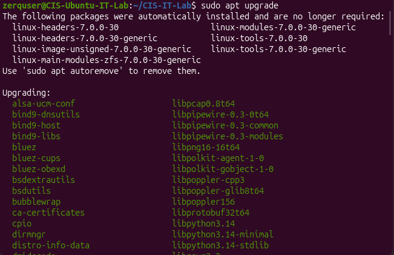

# CIS Virtual IT Lab

## Project Overview
I created a virtual IT lab using Oracle VirtualBox and Ubuntu Linux to gain hands-on experience with operating systems, Linux commands, user management, file permissions, system maintenance, and basic network troubleshooting.

## Tools Used
- Oracle VirtualBox
- Ubuntu Linux
- Linux Terminal

## What I Did

### 1. Virtual Machine Setup
- Created and configured an Ubuntu Linux virtual machine using VirtualBox.
- Installed Ubuntu and explored the Linux desktop and Terminal.

### 2. Linux File Management
- Used commands such as `pwd`, `ls`, `mkdir`, `cd`, `touch`, `echo`, and `cat`.
- Created a project folder and text file using the Terminal.

### 3. User Accounts and File Permissions
- Created a new Linux user named `labemployee`.
- Changed file permissions using `chmod 600`.
- Verified that the new user could not access a private file.

### 4. System Maintenance and Troubleshooting
- Checked for and installed software updates using `apt`.
- Monitored memory, disk usage, and uptime.
- Tested network connectivity using `ping`.

## What I Learned
This project helped me become more comfortable using Linux and the command line. I learned how user accounts and file permissions help protect information, how to perform basic system maintenance, and how to check system resources and network connectivity.

## Screenshots
Screenshots of my work are available in the `screenshots` folder.
## Project Screenshots

### 1. Basic Linux Commands

### 2. File Management

### 3. Linux File Permissions

### 4. System Updates

### 5. Network Connectivity Test

